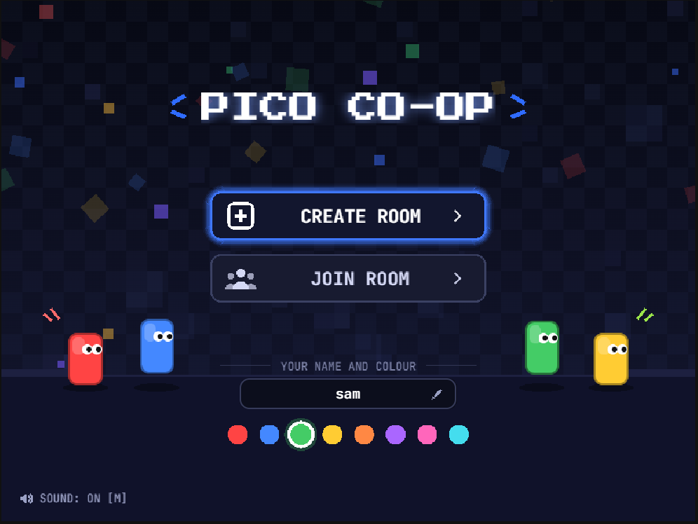
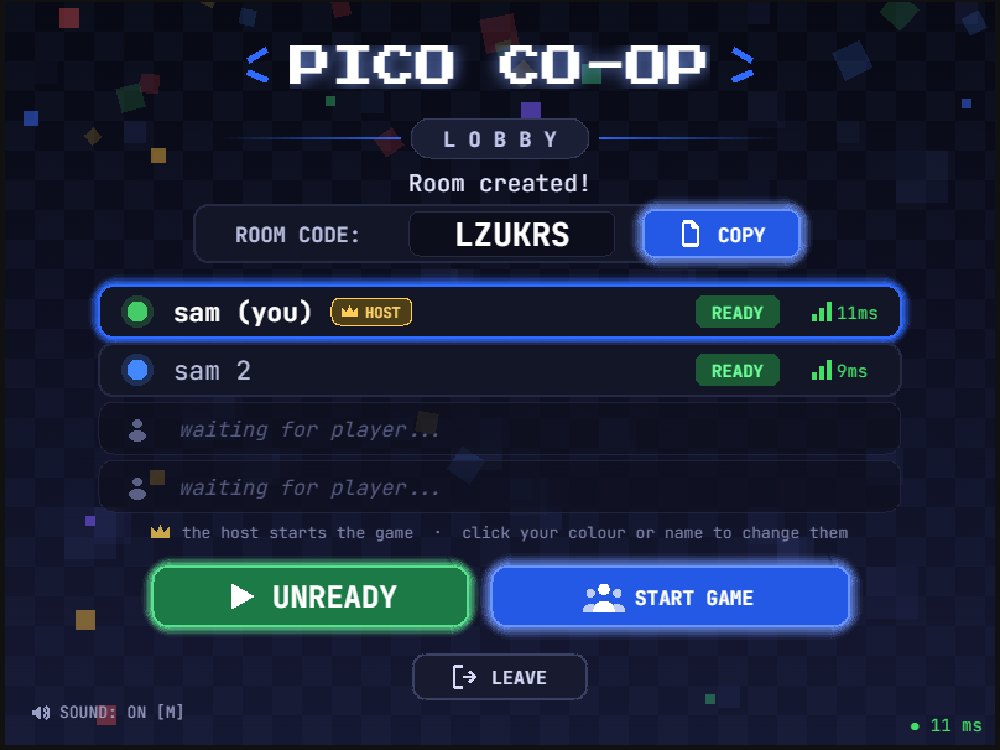
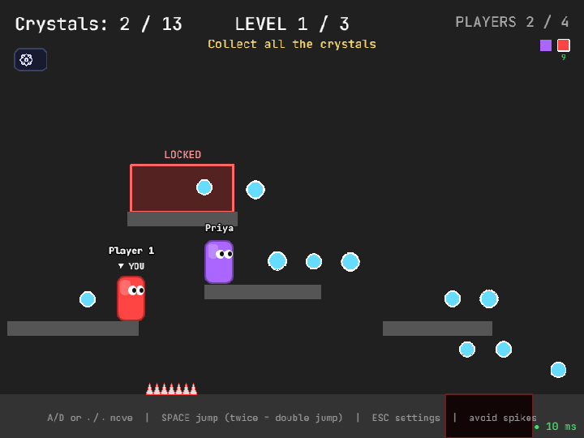
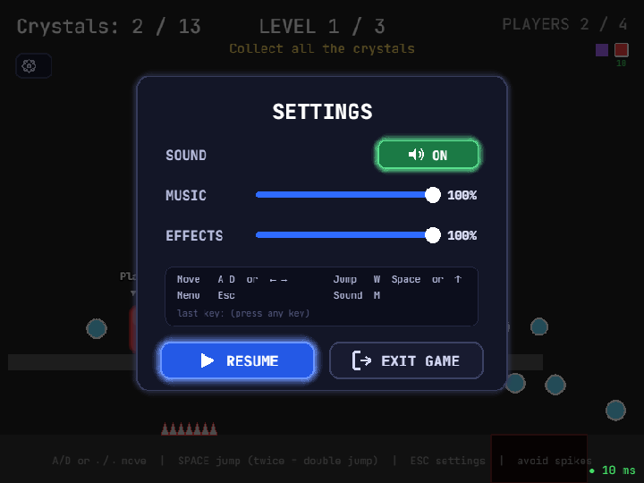
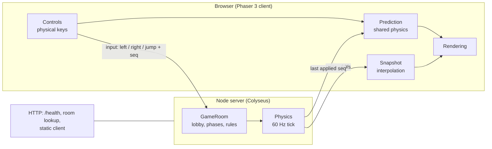

# Pico Co-op

[](https://github.com/adi-samson7/pico-park-game/actions/workflows/ci.yml)


A real-time multiplayer **co-op platformer** for 1–4 players that runs in the browser, inspired by Pico Park.
Players share a room, jump (and double jump), stack on each other's heads, dodge spikes and pits, collect shared
crystals, and must get **every** player through the exit door to clear three levels.

<p align="center">
  
  
</p>
<p align="center">
  
  
</p>

## Contents

- [Features](#features)
- [How to play](#how-to-play)
- [Quick start](#quick-start)
- [Architecture](#architecture)
- [Networking](#networking)
- [Configuration](#configuration)
- [Deployment](#deployment)
- [Testing](#testing)
- [Project layout](#project-layout)
- [Troubleshooting](#troubleshooting)

## Features

**Gameplay**
- Co-op puzzle platforming: double jump, stacking up to three players high, one-way platforms, pits, spikes
- Three levels with shared crystals that unlock the exit; everyone must be inside the door
- **LEVEL CLEAR** and **LEVEL N** screens between levels; movement and timers are held until play starts
- Play again from the same lobby: same room, same code, same host

**Multiplayer**
- 6-character room codes with a one-click **COPY** button; clear **HOST** badge, ready states and per-player ping in the lobby
- Custom names and eight colours, validated by the server (unique, cleaned of markup and odd characters)
- Server-authoritative simulation, client-side prediction, snapshot interpolation
- Survives bad connections: dropped players keep their seat for 30 s and resync, and a page reload resumes the game

**Interface**
- Redesigned menu and lobby, bundled fonts, drifting-block background
- In-game **settings menu** (`Esc` or the cog): sound on/off, music and effects volume, EXIT GAME with confirmation
- Synthesised music and sound effects (no audio files); sound is on by default and remembered
- Keyboard read by physical key, so WASD works with any layout or input method

## How to play

| Key | Action |
| --- | --- |
| `A` / `D` or `←` / `→` | Move |
| `Space`, `W` or `↑` | Jump; press again in the air to double jump |
| `M` | Mute / unmute |
| `Esc` (or the cog) | Settings menu |
| `Enter` | Back to the lobby after the last level |

1. One player clicks **Create Room** and shares the room code (**COPY** puts it on the clipboard).
2. Others click **Join Room** and enter the code.
3. Everyone clicks **Ready**; the host clicks **Start Game**.
4. Collect every crystal to unlock the exit, then get **every** player inside the door.

**Name and colour.** Pick a name (up to 12 characters) and one of eight colours on the menu; they are remembered
in the browser. The server has the last word: it strips anything but letters, digits and a few marks, adds a number
if the name is taken (`Sam`, `Sam 2`), and gives another colour if yours is taken. In the lobby, click your colour
for the next free one, or your name to rename. They are fixed during a game. Left empty, you are "Player N".

**Settings menu.** `Esc` opens it over the running game (other players keep playing; your own movement keys are
off while it is open). Leaving through **EXIT GAME** asks first; once a game has started the room is locked, so you
cannot rejoin it.

## Quick start

Requires **Node 22+**.

```bash
npm run install:all      # installs client/ and server/
npm run dev:server       # terminal 1: game server on http://localhost:2567
npm run dev:client       # terminal 2: client on http://localhost:5173
```

Open <http://localhost:5173> in two browser tabs to play against yourself.

**Production build (one process, one port):**

```bash
npm run build            # builds client/dist and server/dist
npm start                # serves the game, the API and the client on :2567
```

Then open <http://localhost:2567>.

| Script | Purpose |
| --- | --- |
| `npm run dev:server` / `dev:client` | development servers with reload |
| `npm run build` / `npm start` | production build and run |
| `npm test` | unit and integration tests |
| `npm run test:e2e` | headless-Chrome end-to-end tests (build first) |
| `npm run typecheck` | TypeScript for client and server, plus the physics-copy check |
| `npm run sync:physics` | refresh the client's copy of the shared server code |

## Architecture



The server is **authoritative**: clients send only key state; the server simulates movement, collisions, crystals
and the exit, and broadcasts the result about 60 times a second. Rooms and room codes live in the server's memory.

| Layer | Technology |
| --- | --- |
| Client | Phaser 3, TypeScript, Vite, Web Audio (synthesised sound) |
| Server | Node.js 22, Colyseus 0.17, TypeScript |
| Tests | `node:test` via `tsx`, headless Chrome through the DevTools protocol |
| Delivery | Docker (multi-stage, non-root), Render blueprint, GitHub Actions CI |

## Networking

The server is authoritative, so a laggy or flaky connection must not make the game feel laggy or flaky.

| Problem | What the game does |
| --- | --- |
| **Your own movement feels late** | *Client-side prediction*: the client runs the same physics code as the server (`client/src/shared/physics.ts` is a checked-in copy of `server/src/physics.ts`) on your player right away. Every input carries a sequence number and every server state says which one it has applied; if the prediction was wrong (bumped, respawned, a guess about another player) the client takes the server's state, replays the inputs the server has not seen yet and glides the picture to the corrected spot. |
| **Other players stutter** | *Snapshot interpolation*: other players are drawn 50 ms in the past, between two positions that have already arrived, so late packets do not show. |
| **The connection drops** (Wi-Fi blip, closed laptop, **page reload**) | The server keeps the player's seat for 30 s. The client library retries on its own, the screen shows "CONNECTION LOST", other players see the character greyed out, and the returning player gets a full *resync* (roster, level, crystals, door) and is put back at their spawn point. A reload resumes the game too: the tab remembers the room in `sessionStorage`. While someone is away the door does not wait for them and nobody can stand on them. If they do not return in time they are removed like a normal leave. |
| **Who has a bad connection?** | A ping chip (bottom right) and a ping under every player's colour chip: green below 80 ms, yellow below 160 ms, red above. |

Leaving on purpose (LEAVE, EXIT GAME, or ENTER after winning) is never held: it frees the seat immediately.

### For timed missions

The server owns the level phase (`intro`, `playing`, `clear`). Anything that counts time should count from
`levelElapsedMs` in the game state (or the `levelStarted` message): it is 0 during both screens and starts when play
starts. `levelCompleted` reports `elapsedMs`, how long the level was played.

### Switches for comparing and testing (append to the URL)

| URL | Effect |
| --- | --- |
| `?predict=0` | no prediction: the local player is drawn from the server only |
| `?interp=0` / `?interp=150` | draw other players at their latest position / 150 ms in the past |
| `?retries=3` | give up on a lost connection after 3 attempts instead of 10 |
| `?debug` | expose `window.__pico`, `__audio` and `__controls` in a production build (used by the browser tests) |

The client keeps copies of `server/src/physics.ts` and `server/src/profile.ts`. If you change either, run
`npm run sync:physics`: a test and `npm run typecheck` fail while a copy is out of date.

## Configuration

Server environment variables:

| Variable | Default | Meaning |
| --- | --- | --- |
| `PORT` | `2567` | Port to listen on |
| `HOST` | `0.0.0.0` | Interface to bind |
| `CLIENT_DIST` | `../../client/dist` | Directory of the built client to serve |
| `CORS_ORIGIN` | `*` | `Access-Control-Allow-Origin` for the room lookup endpoint |
| `LOG_LEVEL` | (info) | `silent` turns off the game log |
| `LEVEL_CLEAR_SECONDS` | `3` | How long "LEVEL CLEAR" is shown |
| `LEVEL_INTRO_SECONDS` | `3` | How long "LEVEL N" is shown before a level starts |
| `RECONNECT_WINDOW_SECONDS` | `30` | How long a player whose connection dropped keeps their seat |

Client build-time variable:

| Variable | Default | Meaning |
| --- | --- | --- |
| `VITE_SERVER_URL` | dev: `http://localhost:2567`, production: same origin | Where the game server is. Only needed if it is on a different domain than the page. The client uses `wss://` automatically for `https://` pages. |

## Deployment

### Docker

```bash
docker build -t pico-coop .
docker run --rm -p 2567:2567 pico-coop       # http://localhost:2567
```

The image is multi-stage, runs as a non-root user, listens on `$PORT` and has a `HEALTHCHECK` on `/health`.

### Render (or any Docker host)

`render.yaml` is a ready-made blueprint: create a new **Blueprint** from this repository and Render builds the
`Dockerfile`, health-checks `/health`, provides HTTPS and WebSocket support, and sets `PORT`. Any host that runs a
container and supports WebSockets (Fly.io, Railway, a VPS behind a TLS proxy) works the same way.

### Client on Vercel / Firebase Hosting / Netlify

A static host can serve the built client (`client/dist`) but **not the game server**: Vercel and Firebase Functions
are serverless and cannot keep a WebSocket open. Run the game server somewhere that can, and point the client at it.

1. **Deploy the game server first** (Render: *New → Blueprint*, pick this repository). Copy its address, e.g.
   `https://pico-coop.onrender.com`, and check that `https://<address>/health` answers `{"status":"ok",...}`.
2. **Vercel:** *Add New → Project*, import this repository and set
   - **Root Directory:** `client` (the rest comes from `client/vercel.json`: Vite, `npm run build`, output `dist`)
   - **Environment Variable:** `VITE_SERVER_URL` = the server address from step 1 (must be `https://`)

   **Firebase:** `VITE_SERVER_URL=... npm --prefix client run build`, then deploy `client/dist` as the hosting `public` directory.
3. Open the deployed site, create a room, and join it from a second tab.

If `VITE_SERVER_URL` is missing or not `https://`, the Vercel build **stops with a message saying so**
(`client/scripts/check-server-url.mjs`); without that check the game would deploy and then fail on every "Create room".
The address is read when the client is **built**: change it in Vercel and redeploy. To restrict who may query rooms,
set `CORS_ORIGIN=https://your-site.vercel.app` on the server.

### Run a single instance

Rooms and room codes live **in the server's memory**:

- **Do not scale horizontally.** A second instance would not know the first one's rooms. Keep `numInstances: 1`
  (one instance comfortably handles many rooms).
- Restarting or redeploying the server **ends all running games**.
- Free-tier hosts that sleep when idle drop their rooms when they sleep (the first visit after a pause can take up to
  a minute to wake the server).

Going beyond that needs a shared room registry and Colyseus' Redis presence/driver.

## Testing

```bash
npm test                 # unit + integration tests (about 20 s)
npm run test:e2e         # headless-Chrome end-to-end tests against the production build
npm run typecheck
```

CI runs everything on every push (`.github/workflows/ci.yml`). The e2e suite needs `npm run build` first and
Chrome/Chromium (set `CHROME_PATH` if it is not found; `E2E_SCREENSHOTS=<dir>` saves a screenshot per stage). It
skips, with a reason, when it cannot run.

<details>
<summary>What each suite covers</summary>

| Suite | What it covers |
| --- | --- |
| `physics.test.ts` | double jump, stacking (carry, stacks of three, slow ticks), one-way platforms, pits, spikes |
| `levels.test.ts` | level data sanity, safe spawns, an exhaustive search proving every crystal and exit is reachable **alive**, hazards are lethal, four players fit in each door |
| `registry.test.ts` | room code registry |
| `app.test.ts` | `/health`, room lookup, CORS, static client serving, cache headers |
| `rooms.test.ts` | lobby rules, host migration, room locking, input validation, hazards, crystals → door → next level → win |
| `reconnect.test.ts` | dropped connections: the seat is held, full resync, host hand-over, the exit never waits for an absent player, input sequence numbers, latency reports |
| `netcode.test.ts` | interpolation, prediction and reconciliation against the real server physics over simulated latency and jitter (10–400 ms, 30–144 fps), ping bands, session storage |
| `profile.test.ts`, `profile-room.test.ts` | name cleaning (markup, emoji, control and zero-width characters), unique names and colours, joining and changing them, refused during a game, flood protection |
| `client-profile.test.ts` | the remembered profile and the time formatting on screen |
| `intermission.test.ts` | the LEVEL N / LEVEL CLEAR screens: nobody can move, nothing is collected, no timer runs, exact timing, leaving or reconnecting mid-screen |
| `rematch.test.ts` | after the last level the room is a lobby again; a new game starts from there; leaving and joining between rounds |
| `clipboard.test.ts` | copying the room code: clipboard API, fallback for plain http, failure |
| `controls.test.ts` | which physical key an event is, jump once per press, typing and browser shortcuts left alone, keys released on blur |
| `physics-sync.test.ts` | the client's copy of the physics is identical to the server's |
| `vercel.test.ts` | the build guard for `VITE_SERVER_URL` |
| `e2e/game.e2e.ts` | the real UI in Chrome: menu → lobby → game, sounds, animations, effects |
| `e2e/net.e2e.ts` | Chrome through a lag proxy: ping chip, prediction vs. a 300 ms round trip, smooth remote players, outages, reload-and-resume, giving up, stale sessions |
| `e2e/profile.e2e.ts` | the name box (typing must not reach the game), colour swatches, persistence, name and colour in lobby and game |
| `e2e/settings.e2e.ts` | the settings menu (Esc / cog, no movement behind it, sound button, sliders and their persistence, EXIT GAME) and WASD under every key shape a browser can send (keyCode 229, none, Hindi, AZERTY) |
| `e2e/sound.e2e.ts` | sound on for a first visit, the honest label before the first click, an old saved "off" ignored, blocked storage |
| `e2e/screens.e2e.ts` | COPY on a real clipboard, the LEVEL banners and held controls, reloading during a screen, win → ENTER → lobby → a new game |
| `e2e/hosting.e2e.ts` | the client built for another origin talking to the game server: CORS, WebSocket, joining by code, resume |

</details>

## Project layout

```
client/                Phaser game (Vite + TypeScript)
  src/scenes/          Menu, Lobby and Game scenes
  src/audio/           synthesised sound effects and music (no asset files), volume and mute
  src/input/           the keyboard, read by physical key
  src/net/             prediction, interpolation, ping, session resume, connection overlay
  src/ui/              theme, icons, buttons, panels, settings menu (fonts are bundled)
  src/shared/          copy of the server's physics and profile code
  src/effects.ts       particles, confetti, button juice
  src/config.ts        server address
server/                Colyseus game server (Node + TypeScript)
  src/app.ts           HTTP + WebSocket server factory (lookup, /health, static client)
  src/physics.ts       platformer physics (pure functions; the client keeps a copy)
  src/profile.ts       name cleaning and the colour palette (the client keeps a copy)
  src/levels.ts        level data (platforms, crystals, exit, pits, spikes)
  src/rooms/           GameRoom: lobby, game loop, rules
  test/                unit, integration and browser tests
docs/screenshots/      images used in this README
Dockerfile, render.yaml, .github/workflows/ci.yml
```

## Troubleshooting

**A movement key does nothing (Chrome).** Open the settings (`Esc`), press the key, and look at the "last key" line.
- *It does not change:* something intercepts the key before the page. Browser extensions are the usual cause; for
  example, video-speed extensions bind `S`, `D` and `A` and show a round speed badge in the corner. Disable the extension
  for this site, or try an Incognito window.
- *It shows `KeyD ... keyCode 229`:* an input method is active. The game reads the physical key (`event.code`), so this
  works; Phaser's own keys, which go by `keyCode`, did not.

**No sound.** Browsers play nothing until the first click or key press; the label says "CLICK ANYWHERE TO START" until
then. Check the sound button and the volume sliders in the settings.

**"Create room" fails on a deployed client.** The client was built without a reachable `VITE_SERVER_URL`, or the game
server is asleep (free hosts) or not allowing WebSockets. Check `https://<server>/health`.

**Players cannot find a room.** Room codes live in one server's memory; make sure only one instance is running and the
server was not restarted since the room was created.
